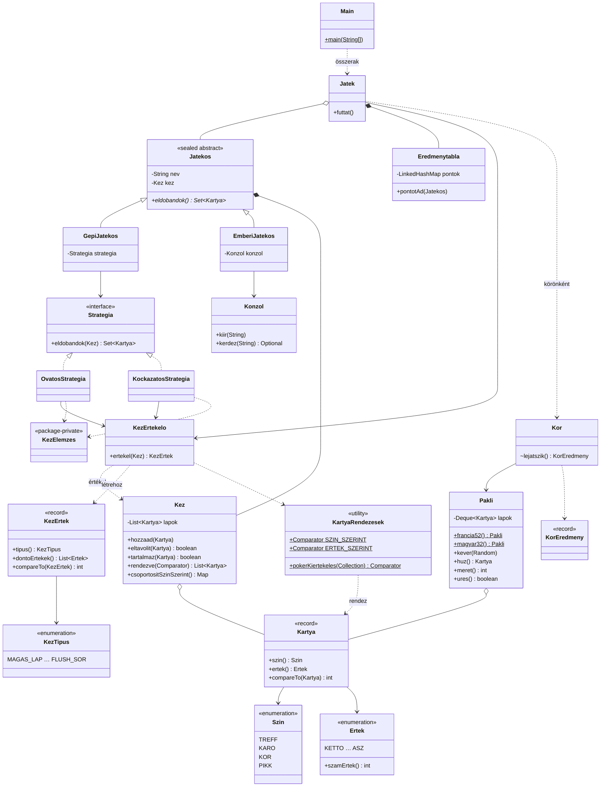

# 5 lapos húzós póker (konzolos kártyajáték)

Egyetemi OOP beadandó Java 21-ben. A gyakorlás fókusza a `Comparable` és a `Comparator`
különbsége, az `equals`/`hashCode` szerződés, valamint a megfelelő gyűjtemény kiválasztása.

## Szabályok (egyszerűsített 5 lapos húzós póker)

- Egy emberi játékos (konzol) és két gépi játékos játszik: **Olga** (óvatos) és **Karcsi** (kockázatos).
- Minden körben új, megkevert pakliból mindenki 5 lapot kap (körbeosztással).
- Mindenki **egyszer** cserélhet 0–3 lapot: eldobja őket, és ugyanennyit húz a pakliból.
- Ezután mindenki leteríti a lapjait, a legerősebb kéz nyer. Holtverseny esetén minden
  holtversenyes játékos pontot kap.
- Nincs tétrakás, csak pontszám. Minden kör után a játékos dönt: új kör (`i`) vagy kilépés (`n`).

Kéztípusok az erőstől a gyengéig:

| Kéz | Példa |
|-----|-------|
| Flush-sor | 9♣ 10♣ B♣ D♣ K♣ |
| Póker | 9 9 9 9 K |
| Full | 9 9 9 K K |
| Flush | 2♣ 9♣ B♣ D♣ K♣ |
| Sor | 9 10 B D K (a kis sor: A-2-3-4-5) |
| Drill | 9 9 9 2 K |
| Két pár | 9 9 2 2 K |
| Egy pár | 9 9 3 2 K |
| Magas lap | semmi a fentiekből |

Azonos kéztípusnál a lapértékek döntenek a „fontossági” sorrendben: először a kombináció
(pl. a pár, fullnál a drill) értéke, utána a kísérők csökkenően. Sornál csak a legmagasabb lap
számít (a kis sorban ez az 5-ös, nem az ász). A színek között nincs erősorrend.

## Fordítás és futtatás

Előfeltétel: JDK 21+ és Maven 3.9+.

```bash
mvn test                              # tesztek futtatása
mvn package                           # target/poker.jar elkészítése (a teszteket is futtatja)
java -jar target/poker.jar            # véletlen játszma, 52 lapos pakli
java -jar target/poker.jar 2026       # seedelt, visszajátszható játszma
java -jar target/poker.jar 2026 magyar  # 32 lapos pakli (7-estől ászig)
```

Lapcserénél a cserélendő lapok sorszámát kell beírni szóközzel vagy vesszővel elválasztva
(pl. `1 3 5`), üres sor = nincs csere. Hibás bevitel (nem szám, tartományon kívüli vagy ismétlődő
sorszám, 3-nál több lap) esetén a program hibaüzenetet ír és újra kérdez.

> **Windows-konzol:** ha az ékezetes betűk (ő, ű) hibásan jelennek meg, állítsd a konzolt UTF-8-ra
> (`chcp 65001`), és futtasd így: `java -Dstdout.encoding=UTF-8 -jar target/poker.jar`.

## Projektszerkezet

```
src/main/java/kartya/
├── Main.java                 belépési pont: argumentumok, objektumok összerakása
├── model/                    Szin, Ertek, Kartya, KartyaRendezesek, Pakli, Kez
├── ertekeles/                KezTipus, KezErtek, KezErtekelo
├── strategia/                Strategia, OvatosStrategia, KockazatosStrategia, KezElemzes
├── jatekos/                  Jatekos (sealed), GepiJatekos, EmberiJatekos
└── jatek/                    Jatek, Kor, KorEredmeny, Eredmenytabla, Konzol
docs/uml.puml                 PlantUML osztálydiagram
```

## Tervezési döntések

### Comparable vs. Comparator

- A `Kartya` **természetes rendezése** (`Comparable`) az, amit „magától értetődőnek” tekintünk:
  először érték, majd szín. Ezt használja például a `TreeSet<Kartya>` vagy a `sorted()` paraméter nélkül.
- Minden más szempont **külső `Comparator`** a `KartyaRendezesek` osztályban, a
  `Comparator.comparing(...).thenComparing(...)` láncolással:
  - `SZIN_SZERINT` – szín, azon belül érték növekvően;
  - `ERTEK_SZERINT` – érték csökkenően, azon belül szín (a kéz megjelenítése);
  - `pokerKiertekeles(lapok)` – a gyakoribb érték előre (pár a kísérők elé, fullnál a drill a pár elé),
    azonos gyakoriságon belül érték csökkenően. Ez **gyártó metódus, nem konstans**, mert a sorrend a
    konkrét kéz értékgyakoriságaitól függ: ugyanaz a király az egyik kézben pár része, a másikban
    kísérő. A kiértékelő ebből a sorrendből olvassa ki a holtversenyt eldöntő értékeket.
- Így a `Kartya` osztályt egyetlen új rendezés kedvéért sem kell módosítani (nyitott/zárt elv).
- A `KezErtek` is `Comparable`: előbb a `KezTipus` (enum, a deklarálás sorrendje az erősorrend),
  utána a döntő értékek lexikografikusan.

### equals/hashCode és a compareTo konzisztenciája

- A `Kartya` **record**, így az `equals`/`hashCode` automatikusan a két komponensből (szín, érték)
  készül. Ezért egyenlő lapok egybeesnek `HashSet`-ben, és új, egyenlő példánnyal is visszakereshetők
  `HashMap`-ből — a lap megváltoztathatatlan, a hash-e tehát sosem változik meg kulcsként.
- A `compareTo` pontosan ugyanazt a két mezőt hasonlítja, ezért `a.compareTo(b) == 0` ⇔ `a.equals(b)`.
  Ez azért fontos, mert a `TreeSet`/`TreeMap` a `compareTo`-val, a `HashSet`/`HashMap` az `equals`-szal
  dönt az egyenlőségről; ha a kettő eltérne, ugyanaz a lapkészlet a két halmazban eltérő méretű lenne.
  (Erre teszt is van: `KartyaTest.compareToKonzisztensEqualsszal`.)
- A `KezErtek` record **szándékosan nem tárolja a lapokat**, csak a típust és a döntő értékeket: két
  kéz, amely csak színben tér el, egyenlő erős. Ha a lapok is a record részei lennének, akkor
  `compareTo == 0` mellett `equals == false` lehetne.
- A `Jatekos` szándékosan az `Object` **identitás alapú** `equals`/`hashCode`-ját örökli: a játékos
  állapota (keze) változik, és két azonos nevű játékos is két különböző résztvevő. Így biztonságos
  kulcs az `Eredmenytabla` `LinkedHashMap`-jében.

### Gyűjtemények

| Hol | Gyűjtemény | Miért |
|-----|-----------|-------|
| `Pakli` | `ArrayDeque` (`Deque`) | Húzás mindig a tetejéről: O(1), és a `Deque` pontosan ezt a szándékot fejezi ki. Index szerinti elérés nem kell. Keveréshez ideiglenesen `ArrayList`-be másolunk, mert a `Collections.shuffle` `List`-et vár. |
| `Kez` | `ArrayList` | Max. 5 lap, így az O(n) keresés elhanyagolható. Stabil, indexelhető sorrend kell (az ember sorszámmal választ), és a sorrend bármely `Comparator`-ral átállítható — ezt egy rögzített rendezésű `TreeSet` nem tudná. A duplikátumot a `hozzaad` szűri. |
| `Kez.csoportositSzinSzerint()` | `EnumMap` (`Collectors.groupingBy`) | Enum kulcsnál tömb-alapú, gyors, kompakt, és a színeket a deklarálás sorrendjében járja be. |
| `Strategia.eldobandok` | `Set` | Ugyanazt a lapot kétszer eldobni értelmetlen; a „hány és melyik” kérdésre a halmaz a természetes válasz. |
| `Eredmenytabla` | `LinkedHashMap` | O(1) frissítés, és pontegyenlőségnél a kiírás az ülésrendet követi. |
| `EmberiJatekos` sorszámai | `TreeSet` | Ismétlődés felismerése (`add` → `false`) és rendezett sorszámok. |

### A 32 lapos pakli: francia enumokból, nem külön `MagyarSzin`

A `Pakli.magyar32()` a meglévő `Szin`/`Ertek` enumokból a 7-estől az ászig terjedő lapokat veszi.
Indoklás:

- **Egy lap-típus:** külön `MagyarSzin`/`MagyarErtek` enum esetén vagy generikussá kellene tenni a
  `Kartya`, `Kez`, `KezErtekelo` és a stratégiák mindegyikét (`Kartya<S extends Enum<S>, E ...>`), vagy
  minden osztályból két példány kellene. A póker szabályai a két paklinál azonosak, tehát ez csak
  bonyolultságot hozna.
- **Ugyanazok a rendezések és tesztek** működnek mindkét paklira.
- Az egyetlen valódi különbség a **kis sor**: 52 lapnál A-2-3-4-5, 32 lapnál A-7-8-9-10. Ezt a
  `KezErtekelo` a pakli legkisebb lapértékéből (`Pakli.legkisebbErtek()`) számolja.
- Egyszerűsítés: a kéztípusok sorrendje 32 lapnál is a megszokott marad (a valódi „rövid paklis”
  pókerben a flush néha a full fölé kerül).

### Egyéb

- **Strategy minta:** a `GepiJatekos` egy `Strategia` (funkcionális interfész) példányra bízza a döntést.
  Az interfész szándékosan nem sealed — új stratégia a meglévő kód módosítása nélkül hozzáadható.
  A közös kézelemző segédfüggvények a csomagszintű `KezElemzes` osztályban vannak.
- **Sealed `Jatekos`:** pontosan két fajta játékos van, így a `Kor` a cserét követő üzenetet
  `switch` mintaillesztéssel, `default` ág nélkül írja ki.
- **A stratégiák ellenőrzése:** a `Kor` minden eldobási halmazt ellenőriz (≤ 3 lap, mind a kézből),
  így egy hibás stratégia sem tud csalni.
- **Determinisztikusság:** minden véletlen egyetlen, kívülről kapott `Random` példányból jön. Azonos
  seed és azonos bemenet esetén a játszma bájtra pontosan megismétlődik (`JatekTest`).
- **Kis osztályok:** a `Main` csak összerak, a `Jatek` a köröket ismétli, a `Kor` egy kört bonyolít,
  az `Eredmenytabla` a pontokat vezeti, a `Konzol` a be-/kimenetet kezeli.

## Tesztek

`mvn test` → 37 tesztmetódus (paraméterezett esetekkel együtt 53 futás), mind zöld.

| Tesztosztály | Mit ellenőriz |
|--------------|---------------|
| `KartyaTest` | természetes rendezés; `HashSet`/`HashMap` viselkedés; `compareTo`–`equals` konzisztencia |
| `KartyaRendezesekTest` | mindhárom rendezés egy rögzített listán |
| `PakliTest` | 52 / 32 lap duplikátum nélkül (`Set`-tel); azonos/eltérő seed; húzás üres paklinál |
| `KezTest` | keresés, eltávolítás, korlátok, szín szerinti csoportosítás `EnumMap`-be |
| `KezErtekeloTest` | minden kéztípus; erősorrend; holtverseny (pl. királypár > dámapár); kis sor 52 és 32 lapnál |
| `StrategiaTest` | 1000 véletlen kézre érvényes eldobási halmaz; jellemző döntések |
| `EmberiJatekosTest` | bevitel-validálás, újrakérdezés, bemenet vége |
| `JatekTest` | seedelt játszma pontos visszajátszása; túl sok játékos elutasítása |

## UML osztálydiagram

A PlantUML forrás: [`docs/uml.puml`](docs/uml.puml). Mermaid változat:



## Mintajáték

Valódi futás kimenete (`seed = 2026`, 52 lapos pakli). A bemenetet fájlból irányítottuk át, ezért a
program visszaírja a beolvasott sorokat; az első körben látszik a hibás bevitel kezelése is.

```text
$ java -jar target/poker.jar 2026
5 lapos húzós póker — 52 lapos pakli, seed: 2026

===== 1. kör =====
Lapjaid:
  1) Káró Ász
  2) Pikk 9
  3) Treff 8
  4) Pikk 4
  5) Kőr 2
Cserélendő lapok sorszámai (pl. 1 3 5, legfeljebb 3), Enter = nincs csere: 2 3 4 5
Hibás bemenet: Legfeljebb 3 lapot cserélhetsz. Próbáld újra!
Cserélendő lapok sorszámai (pl. 1 3 5, legfeljebb 3), Enter = nincs csere: 3 4 5
Új lapjaid: Káró Ász, Pikk Dáma, Treff 10, Pikk 9, Káró 3
Olga [óvatos] 3 lapot cserélt.
Karcsi [kockázatos] 1 lapot cserélt.

--- Leterítés ---
Te                   Káró Ász, Pikk Dáma, Treff 10, Pikk 9, Káró 3                -> Magas lap (Ász, Dáma, 10, 9, 3)
Olga [óvatos]        Treff 7, Pikk 7, Pikk 6, Káró 4, Pikk 3                      -> Egy pár (7, 6, 4, 3)
Karcsi [kockázatos]  Kőr Ász, Pikk Király, Káró Dáma, Kőr Bubi, Káró 10           -> Sor (Ász)
Nyertes: Karcsi — Sor

Állás 1 kör után:
  Karcsi               1 pont
  Te                   0 pont
  Olga                 0 pont
Új kör? (i/n): i

===== 2. kör =====
Lapjaid:
  1) Kőr Király
  2) Káró Bubi
  3) Kőr 10
  4) Káró 9
  5) Pikk 8
Cserélendő lapok sorszámai (pl. 1 3 5, legfeljebb 3), Enter = nincs csere: 1
Új lapjaid: Pikk Ász, Káró Bubi, Kőr 10, Káró 9, Pikk 8
Olga [óvatos] 3 lapot cserélt.
Karcsi [kockázatos] 1 lapot cserélt.

--- Leterítés ---
Te                   Pikk Ász, Káró Bubi, Kőr 10, Káró 9, Pikk 8                  -> Magas lap (Ász, Bubi, 10, 9, 8)
Olga [óvatos]        Treff Dáma, Káró Dáma, Kőr Dáma, Pikk Bubi, Kőr 8            -> Drill (Dáma, Bubi, 8)
Karcsi [kockázatos]  Treff Király, Kőr Bubi, Káró 10, Pikk 9, Káró 3              -> Magas lap (Király, Bubi, 10, 9, 3)
Nyertes: Olga — Drill

Állás 2 kör után:
  Olga                 1 pont
  Karcsi               1 pont
  Te                   0 pont
Új kör? (i/n): i

===== 3. kör =====
Lapjaid:
  1) Káró Király
  2) Pikk 10
  3) Káró 9
  4) Káró 7
  5) Treff 3
Cserélendő lapok sorszámai (pl. 1 3 5, legfeljebb 3), Enter = nincs csere: 2 5
Új lapjaid: Káró Király, Pikk Bubi, Káró 9, Káró 7, Treff 4
Olga [óvatos] 3 lapot cserélt.
Karcsi [kockázatos] 3 lapot cserélt.

--- Leterítés ---
Te                   Káró Király, Pikk Bubi, Káró 9, Káró 7, Treff 4              -> Magas lap (Király, Bubi, 9, 7, 4)
Olga [óvatos]        Treff 2, Pikk 2, Káró Bubi, Treff 8, Káró 3                  -> Egy pár (2, Bubi, 8, 3)
Karcsi [kockázatos]  Kőr 7, Pikk 7, Pikk 9, Káró 4, Pikk 3                        -> Egy pár (7, 9, 4, 3)
Nyertes: Karcsi — Egy pár

Állás 3 kör után:
  Karcsi               2 pont
  Olga                 1 pont
  Te                   0 pont
Új kör? (i/n): n
Köszönöm a játékot!
```
